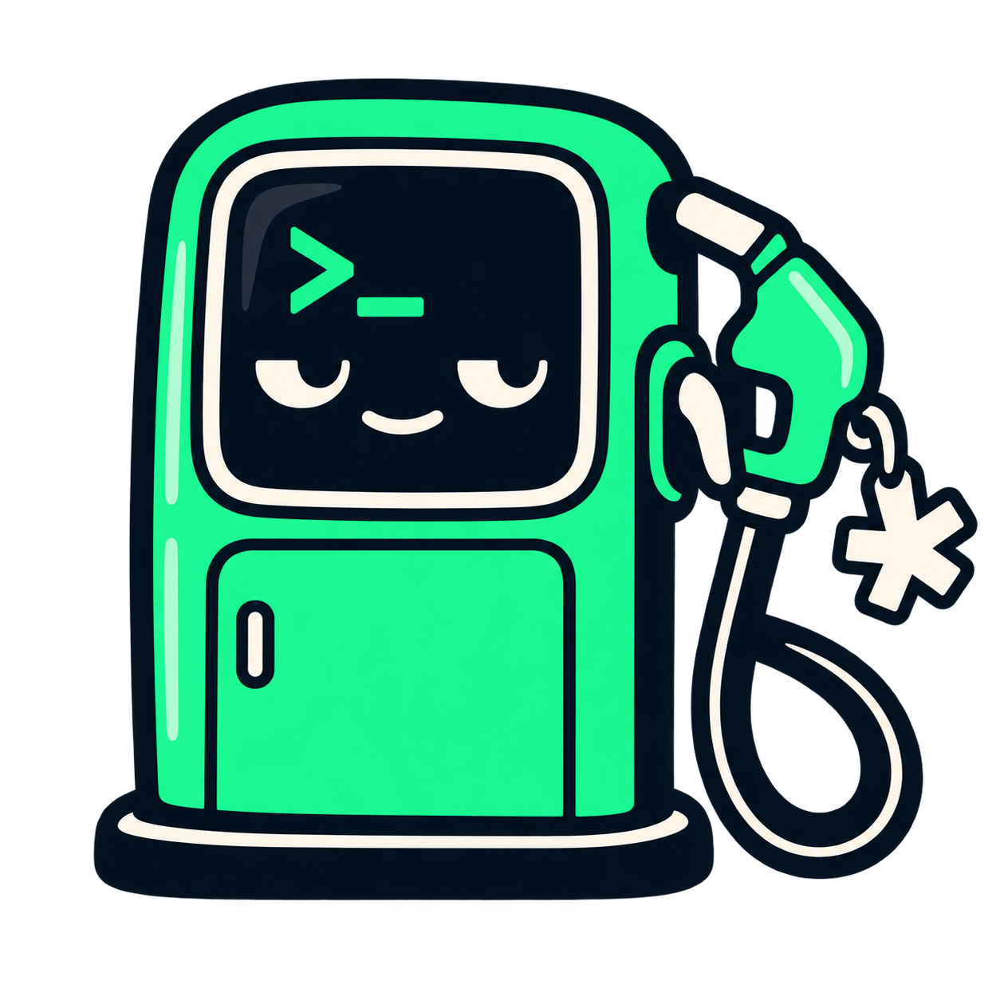
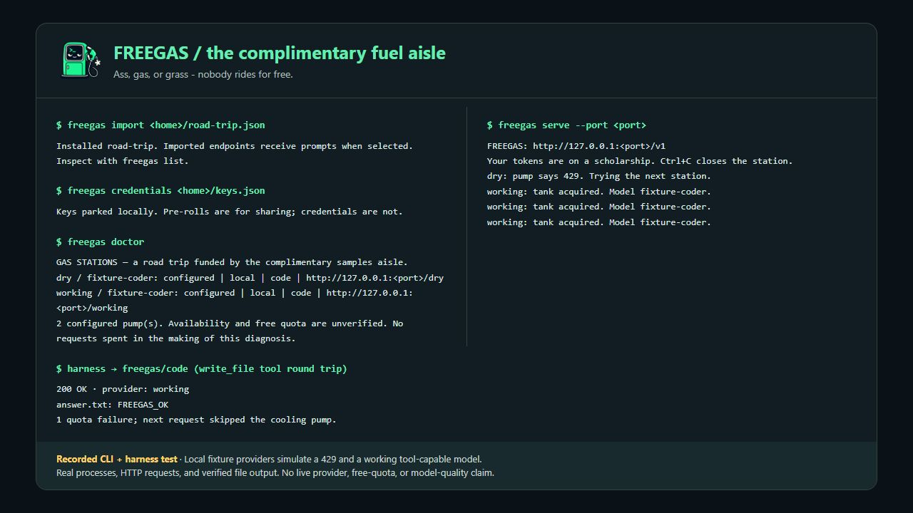

# Freegas

> Ass, gas, or grass - nobody rides for free.

<!-- markdownlint-configure-file { "MD033": { "allowed_elements": ["p", "a", "img", "picture", "source"] } } -->

<p align="center">
  
</p>

<p align="center">
  <a href="https://github.com/rainmana/freegas/actions/workflows/release.yml"></a>
  <a href="package.json"></a>
  <a href="LICENSE"></a>
  <a href="https://github.com/rainmana/freegas/stargazers"></a>
</p>

<p align="center">
  <a href="#pull-up-to-the-pump">Quickstart</a> &nbsp;·&nbsp;
  <a href="#the-dashboard">CLI</a> &nbsp;·&nbsp;
  <a href="#bring-your-pre-rolls-leave-the-keys-at-home">Pre-rolls</a> &nbsp;·&nbsp;
  <a href="#two-pentesters-walk-into-a-token-bill">Origin story</a> &nbsp;·&nbsp;
  <a href="#fuel-deliveries-and-future-pit-stops">Roadmap</a>
</p>

Your coding agent has selected **gas**. Your bank account has selected **please stop**.

Nothing is really free. Freegas does its best to simulate it: load a **Pre-roll** (a shareable provider list), pull into the available **Gas Stations**, and stretch legitimate free inference quotas as far as they'll go. The bill may arrive as rate limits, weaker models, or your data. Assume your prompts and code may be part of the bargain until you've checked each provider's terms.

Freegas takes your legitimate free-tier API keys, visits your configured **Gas Stations**, and switches pumps when a provider runs dry. Put [Traceloop Hub](https://github.com/traceloop/hub) in the driver's seat, point an OpenAI Chat Completions-compatible harness at it, and let your token budget ride shotgun.

An idea from Alec and Ben, somewhere between useful infrastructure and a gas station parking lot joke. [Here's how we got here](#two-pentesters-walk-into-a-token-bill). Champagne prompts. Complimentary-sample budget.

**Working prototype, road-tested:** the actual Traceloop Hub → Freegas → Venice route passed a live tool round trip and streamed text. OpenCode 1.19.3 also completed a streamed coding session and wrote a verified test file through that route. These checks establish interoperability for that setup, not universal model compatibility or free account quotas. See the [test record](docs/verification.md).

---

## A quick lap around the station



Captured from real CLI processes and HTTP requests in the automated user test, rendered in a transcript viewer. Local fixture providers simulate the quota failure and tool-capable response; this is not a live provider or free-quota demonstration. Reproduce it with `npm run demo`.

## Pull up to the pump

You need Node.js **22.16+**. No npm dependencies, subscriptions, or secret handshake. From this checkout:

```sh
node bin/freegas.js init
```

Get your own key at [Groq](https://console.groq.com/keys) and/or [OpenRouter](https://openrouter.ai/settings/keys), then set the matching variable. PowerShell:

```powershell
$env:GROQ_API_KEY = 'your-key'
$env:OPENROUTER_API_KEY = 'your-other-key'
node bin/freegas.js stations
node bin/freegas.js serve
```

On macOS/Linux, use `export GROQ_API_KEY='your-key'`. One key is enough to start; multiple stations enable fallback. For file-based credential setup, see [Pre-rolls and credentials](docs/lists.md).

The starter includes Groq's `llama-3.3-70b-versatile`, OpenRouter's `openrouter/free` router, and an optional local Ollama pump (`ollama pull qwen2.5-coder:7b`). Ollama must already be running; Freegas does not install models. Its conservative 4K context budget and lack of declared tool support mean tool-calling requests stay with compatible cloud stations.

Run `npm link` to install the `freegas` command from this checkout. Otherwise use `node bin/freegas.js` wherever the docs say `freegas`. This package is not published to npm.

## The dashboard

| Command | What happens at the station |
| --- | --- |
| `freegas init` | Opens your first Gas Station with a starter Pre-roll |
| `freegas stations` | Shows models, endpoints, and missing keys (`list` also works) |
| `freegas doctor` | Checks configuration without spending inference requests |
| `freegas serve` | Opens the local pump; `--quiet` silences route chatter |
| `freegas import team-code.json` | Validates and installs another Pre-roll |
| `freegas import https://example.org/code.json` | Imports a shared list over HTTPS |
| `freegas export starter` | Prints a shareable list containing key names only |
| `freegas credentials ./my-keys.json` | Merges keys into private local storage |
| `freegas hub` | Generates configuration for Traceloop Hub |

All commands accept `--home DIR`; default storage is `.freegas` in the current directory, ignored by Git. Set `FREEGAS_HOME` to an absolute directory to share stations across projects. `serve --port 5050` changes the direct port; update Hub's `base_url` to match.

## Put Hub in the driver's seat

```text
Coding harness → Traceloop Hub → Freegas → eligible Gas Station
                    :3000         :4040     Groq / OpenRouter / your list
```

```sh
freegas hub
freegas serve
```

In another terminal, start your installed Hub binary with `CONFIG_FILE_PATH` set to the absolute path printed by `freegas hub`. Configure the harness with:

| Setting | Value |
| --- | --- |
| Hub base URL | `http://127.0.0.1:3000/api/v1` |
| Model | `freegas/code` or `freegas/auto` |
| API key | `freegas-local` (placeholder for clients that require one) |

See [Hub setup](docs/hub.md) for commands, local authentication, and Docker networking. **Set `TRACE_CONTENT_ENABLED=false` in Hub's environment**: the tested Hub ignores the corresponding YAML setting. Hub is a separate Apache-2.0 project; Freegas does not bundle it.

For a quick test without Hub, use the direct base URL `http://127.0.0.1:4040/v1`:

```sh
curl http://127.0.0.1:4040/v1/chat/completions \
  -H 'Content-Type: application/json' \
  -d '{"model":"freegas/code","messages":[{"role":"user","content":"Write a Python hello world"}],"max_tokens":256}'
```

Harnesses must support **Chat Completions** with a custom base URL and model. There is no Responses API or native Anthropic Messages adapter yet. [OpenCode has a tested recipe](docs/hub.md#opencode). “Any harness” is the destination; this version has a specific driveway.

## Bring your Pre-rolls. Leave the keys at home

**Pre-rolls** are shareable JSON provider lists for coding, writing, research, or local models. They define endpoints, models, task tags, capabilities, priorities, and whether access is a free tier, trial, or local. Credentials are referenced by environment-variable name and imported separately. Ben named them; please direct all dispensary-related puns to the passenger seat.

[Free-LLM](https://github.com/nejib1/Free-LLM) is a useful discovery map. A directory entry does not establish a working API, free account quota, or model capability. This version imports the [Freegas JSON format](docs/lists.md), not arbitrary Markdown tables. Use directories to curate lists; automatic directory adapters are a future pit stop.

**Importing a list trusts its endpoints with eligible future prompts and named credentials.** Inspect community lists first. HTTPS imports reject redirects. `source` records provenance; it is not a signature or trust guarantee.

## How it picks a Gas Station

1. Read the requested task: `freegas/code`, `freegas/chat`, or any task tag in your lists. `freegas/auto` considers all tasks; no extra LLM call classifies your prompt.
2. Skip missing credentials, disabled trials, cooldowns, unsupported tools/images/JSON modes, and models too small for the estimated context.
3. Rank by list priority, then recent failures, active requests, and response-header latency. Deterministic routing with health feedback; no model-quality benchmark implied.
4. Try each eligible model at most once. A 429 observes `Retry-After`; auth, depleted-credit, missing-model, timeout, network, and server failures try the next pump. Other request errors return immediately.
5. Forward successful response bytes, including SSE tool-call deltas. After accepting a response, Freegas never replays it elsewhere. An interrupted stream ends the connection.

Typical cooldowns are 30 seconds, or five minutes for auth/credit/model errors; explicit retry delays are bounded to one day. Health resets on restart and is per model/process; multiple processes do not coordinate quotas. Context estimation budgets roughly one token per serialized character plus image/output reserves. It is not an exact tokenizer.

## Nobody rides for free, technically

Free tiers have quotas, privacy terms, and enthusiastic upsell departments. `offer: free` is list metadata, not billing enforcement: your account may have paid billing enabled. Use provider-side spending limits and appropriate free accounts. Trial models are disabled unless you edit `allowTrials` in `.freegas/config.json`.

Freegas uses accounts you legitimately control. No account juggling, ban evasion, or turning a rate limit into a personality contest. Prompts may move between configured providers on retry; review their data policies before sending code or secrets. Freegas logs provider/model IDs, never prompt bodies or keys.

## Two pentesters walk into a token bill

Ben and Alec work together as pentesters and often hang out outside of work. During one of those hangouts, Ben was lamenting how much inference tokens cost. Alec agreed. The machines were thinking. The wallets were suffering.

Alec found projects like [Free-LLM](https://github.com/nejib1/Free-LLM), a directory of free inference providers, and [Traceloop Hub](https://github.com/traceloop/hub), an LLM gateway, and showed Ben the ingredients: there really were "free" inference providers, and a way to put a local endpoint in front of them. What if the endpoint could work through those providers as their quotas ran dry?

Being security professionals, neither mistook a zero-dollar price tag for a promise of privacy. Those **sweet, sweet inference tokens** come with terms. Depending on the provider, your prompts, code, or other data may be part of the bargain. Check before you fill up. As the legendary adage goes: **"Ass, gas, or grass - nobody rides for free."**

But maybe you could simulate free. When gas, groceries, and seemingly everything else already want a piece of your paycheck, stretching some legitimate free-tier quotas can at least make the next token bill hurt a little less.

That's how Freegas was born: a useful tool, a parking lot joke, and two pentesters trying to get a few more miles out of the complimentary fuel vouchers.

## Under the hood

```sh
npm run check
npm test
```

Tests cover HTTP quota fallback, credential handling, selection, streaming/interrupted streams, redirects, timeouts, request validation, CLI imports/exports, and release guards. CI covers Windows, Linux, and macOS with Node 22 and 24, including an extracted release-package smoke test. A separate job builds pinned Hub source and exercises the actual gateway with deterministic providers. Live inference is opt-in; CI does not spend provider credits. See [verification](docs/verification.md) for observed results and remaining limits.

## Fuel deliveries and future pit stops

Freegas stays on **Node.js for now**. [Release automation](docs/releases.md) proposes version/changelog PRs from Conventional Commits. Merging a version PR runs the full test/package matrix and real Hub check before creating its version tag and publishing a GitHub Release with the tested `.tgz` and SHA-256 checksums. No separate npm registry publication is configured. The tarball requires Node; it is not a native executable.

**Rust and download-and-run binaries are a stretch target:** [issue #4](https://github.com/rainmana/freegas/issues/4). The goal is standalone Windows, Linux, and macOS releases, with behavior parity and platform smoke tests before switching implementations. There is no migration date or native-binary promise yet; see [the acceptance targets](docs/future-rust.md).

Other pit stops: persistent quota budgets, directory-import previews, and more tested harness recipes. Contributions welcome, especially sourced Pre-rolls and errors that make you exhale through your nose. See [CONTRIBUTING.md](CONTRIBUTING.md).

MIT licensed. Original repository-template notices remain in [LICENSE](LICENSE). Thanks to [Traceloop Hub](https://github.com/traceloop/hub), [Free-LLM](https://github.com/nejib1/Free-LLM), and the people running the actual Gas Stations.

---

## Star history

<p align="center">
  <a href="https://www.star-history.com/#rainmana/freegas&amp;Date">
    <picture>
      <source media="(prefers-color-scheme: dark)" srcset="https://api.star-history.com/svg?repos=rainmana/freegas&amp;type=Date&amp;theme=dark">
      <source media="(prefers-color-scheme: light)" srcset="https://api.star-history.com/svg?repos=rainmana/freegas&amp;type=Date">
      
    </picture>
  </a>
</p>

---

## Personal capacity and employer disclosure

Freegas is an independent personal project. Alec and Ben participate solely in their individual capacities, and contributors speak only for themselves. Neither Alec nor Ben acts as an agent, representative, or spokesperson for any employer in connection with this project.

All code, documentation, statements, opinions, examples, demonstrations, generated outputs, comments, discussions, humor, and other materials in or associated with this repository are provided in that personal capacity. Nothing in this repository or its associated communications represents, states, or should be construed as reflecting the views, positions, policies, practices, products, services, or official guidance of any past or present employer of Alec, Ben, or any contributor, or of any such employer's affiliates or personnel.

No employer sponsorship, endorsement, approval, review, authorization, or assumption of responsibility is expressed or implied by this project's existence, publication, distribution, or use. References to employment, professional roles, qualifications, or experience are personal background only; they do not establish an affiliation between this project and an employer or authorize anyone to speak on an employer's behalf. References or links to third-party materials likewise do not constitute employer endorsement.

This disclosure does not supersede applicable law, employment obligations, third-party rights, or the terms of this repository's license.
